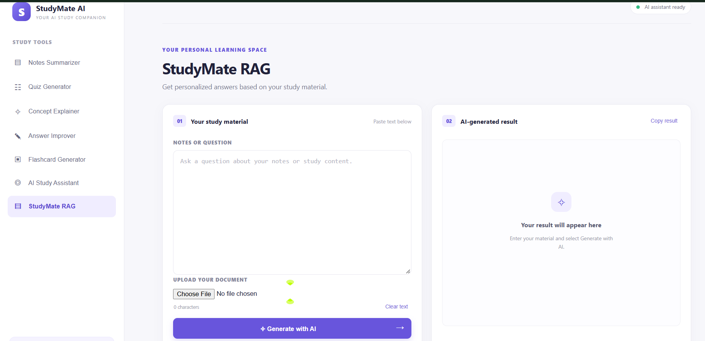

# StudyMate AI 📚

**An AI-powered study assistant built using Java, Spring Boot, Ollama, and Llama 3.2.**

StudyMate AI helps students understand concepts, prepare for exams, improve answers, and organize study materials using locally running AI.

## 🚀 Features

1. **Notes Summarizer** – Converts lengthy study notes into concise summaries.
2. **Quiz Generator** – Generates practice questions from study material.
3. **Concept Explainer** – Explains difficult topics in simple language.
4. **Answer Improver** – Improves the clarity and quality of written answers.
5. **Flashcard Generator** – Creates flashcards for quick revision.
6. **AI Study Assistant** – Answers study-related questions.
7. **StudyMate RAG** – Upload PDF or TXT documents and ask questions based on their content using Retrieval-Augmented Generation (RAG).

## 🛠️ Technologies Used

| Technology | Purpose |
|---|---|
| Java 21 | Backend programming |
| Spring Boot | Backend framework |
| Ollama | Local AI model runtime |
| PDFBox | PDF text extraction |
| RAG | Document-based question answering |
| Llama 3.2 (3B) | AI language model |
| HTML | Frontend structure |
| CSS | Frontend styling |
| JavaScript | Frontend functionality |
| Maven | Dependency management |

## ⚙️ Requirements

- Java JDK 21
- Apache Maven 3.10.1
- Ollama
- Llama 3.2 (3B)

## 📥 Installation and Setup

### 1. Clone the Repository

```bash
git clone https://github.com/pranjaltripathi27/StudyMate-AI.git
```

### 2. Open the Project

```bash
cd StudyMate-AI
```

### 3. Download the AI Model

Install Ollama and run:

```bash
ollama pull llama3.2:3b
ollama pull nomic-embed-text
```

### 4. Start Ollama

Make sure Ollama is running on your computer.

### 5. Build the Project

```bash
mvn clean package -DskipTests
```

### 6. Run the Application

```bash
mvn spring-boot:run
```

### 7. Open in Browser

Visit:

```text
http://localhost:8080
```

## 🏗️ Project Architecture

```text
                                 STUDYMATE AI
                         |
          +--------------+--------------+
          |                             |
      Frontend UI                  Backend
   (HTML, CSS, JavaScript)       (Spring Boot)
          |                             |
          |                 +-----------+-----------+
          |                 |                       |
          |             AI Service              RAG Service
          |                 |                       |
          |              Ollama              Document Processing
          |                 |                 (PDFBox / TXT)
          |             Llama 3.2                   |
          |                 |                  Text Chunking
          |             AI Response                  |
          |                                    Embeddings
          |                                  (nomic-embed-text)
          |                                         |
          +--------------------------------- Vector Store
                                                    |
                                             Relevant Context
                                                    |
                                              AI Response
```

## 📂 Project Structure

```text
StudyMate-AI/
│
├── src/
│   └── main/
│       ├── java/
│       │   └── com/
│       │       └── studymate/
│       │           ├── config/
│       │           │
│       │           ├── controller/
│       │           │   └── DocumentController.java
│       │           │
│       │           ├── dto/
│       │           │
│       │           ├── service/
│       │           │   ├── AiService.java
│       │           │   ├── DocumentService.java
│       │           │   ├── EmbeddingService.java
│       │           │   ├── RagService.java
│       │           │   ├── TextChunker.java
│       │           │   └── VectorStore.java
│       │           │
│       │           └── StudyMateApplication.java
│       │
│       └── resources/
│           ├── static/
│           │   ├── index.html
│           │   ├── styles.css
│           │   └── app.js
│           │
│           └── application.properties
│
├── screenshots/
│   └── dashboard.png
│
├── pom.xml
├── .gitignore
└── README.md
```

## 🔒 AI Model and Privacy

StudyMate AI uses Ollama to run the Llama 3.2 model locally. It does not require an OpenAI API key for its current configuration.

## 🎯 Project Objective

The main objective of StudyMate AI is to make learning easier and more efficient by providing students with AI-powered tools for summarization, practice, revision, and concept clarification.

## 👨‍💻 Author

**Pranjal Mani Tripathi**

GitHub: [@pranjaltripathi27](https://github.com/pranjaltripathi27)

---

**StudyMate AI – Making Learning Smarter with AI.**
## 🖥️ Application Screenshot

